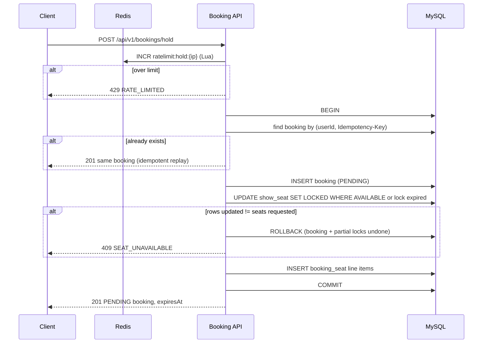
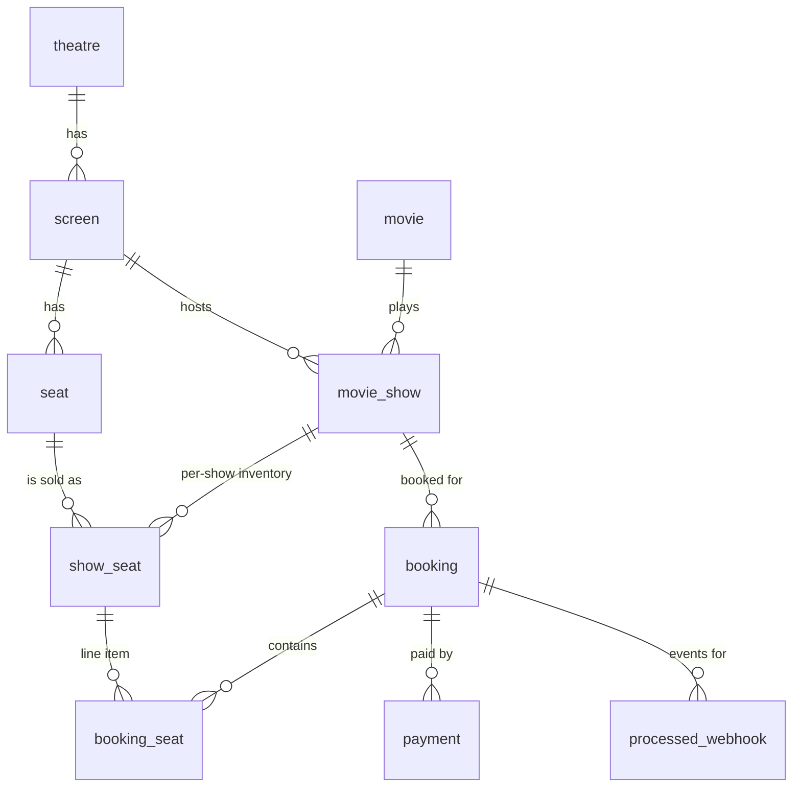

# TicketRush

A high-concurrency movie ticket booking backend. When hundreds of users go after the same seat at the same moment, exactly one wins, everyone else gets a clean `409`, and abusive traffic is stopped at the door with a `429`.

**Status:** in active development. The seat-hold flow, concurrency safety, rate limiting and hold expiry are done and tested. Booking confirmation and payments are next (see [Roadmap](#roadmap)).

**Stack:** Java 21 · Spring Boot 4.1 · Spring Data JPA · MySQL · Redis · Maven

---

## What it solves

| Problem | Solution |
|---|---|
| Two users grab the same seat at the same time | Single atomic conditional `UPDATE` in MySQL. Only one transaction can flip a seat from `AVAILABLE` to `LOCKED` |
| Spikes and abusive clients hammering the hold endpoint | Redis rate limiter (Lua script), 5 requests per 10 seconds per IP, returns `429` with `Retry-After` |
| Client retries creating duplicate bookings | `Idempotency-Key` header, scoped per user, backed by a unique constraint |
| Abandoned seats stay locked forever | 7-minute hold, lazily reclaimed on the next hold attempt and swept by a scheduler every 15 s |
| Seat map reads hitting the DB on every page load | Redis cache with a 5-second TTL |

---

## How a seat hold works



### Key design decisions

- **Atomic claim instead of read-then-write.** Seats are claimed with one conditional `UPDATE ... WHERE status = 'AVAILABLE' OR (status = 'LOCKED' AND locked_until <= now)`. The database decides the winner, so there is no check-then-act race in application code.
- **All-or-nothing multi-seat holds.** If the updated row count differs from the number of seats requested, a `SeatUnavailableException` rolls back the whole transaction. No partial holds, no orphan `PENDING` bookings.
- **Deadlock avoidance.** Seat IDs are de-duplicated and sorted before locking so concurrent multi-seat requests always acquire row locks in the same order.
- **Server-side pricing.** Prices are read from the database, never from the request.
- **Lazy + scheduled expiry.** Expired locks can be taken immediately by the next request; a background job tidies bookings and seats every 15 seconds.
- **Fail open on Redis outage.** If Redis is down, the rate limiter and the cache are skipped rather than taking booking down with them. Correctness comes from MySQL, not Redis.

---

## API

### `GET /api/v1/shows/{showId}/seats`

Returns the seat map for a show. Expired locks are reported as `AVAILABLE`. Cached for 5 seconds.

```json
[
  { "showSeatId": 1, "seatNumber": "A1", "seatType": "REGULAR", "price": 250.00, "status": "AVAILABLE" }
]
```

### `POST /api/v1/bookings/hold`

Holds seats for 7 minutes.

**Headers:** `Idempotency-Key: <unique string per attempt>`

```json
{ "userId": 42, "showId": 1, "showSeatIds": [1, 2] }
```

| Status | Meaning |
|---|---|
| `201` | Seats held. Returns the `PENDING` booking, total amount and `expiresAt` |
| `409` | `SEAT_UNAVAILABLE`: a seat was taken or does not exist for this show |
| `429` | `RATE_LIMITED`: more than 5 requests in 10 s from this IP. See the `Retry-After` header |

---

## Verification

**Concurrency test** (`BookingConcurrencyTest`): 50 threads released at the same instant, all requesting the same seat.

```
Results -> Winner: 1 | Rejected (409): 49 | Errors: 0
```

Exactly one hold succeeds, 49 fail cleanly with a conflict, and there are zero deadlocks or timeouts.

**Load test** (Postman, spike profile): 1,200 requests over 1 minute, 10 virtual users.

| Avg | P90 | P95 | P99 | Server errors |
|---|---|---|---|---|
| 32 ms | 51 ms | 57 ms | 74 ms | 0% |

---

## Database



Full DDL is in [`db/schema.sql`](db/schema.sql). The constraints that carry the correctness guarantees:

| Constraint | Table | Purpose |
|---|---|---|
| `UNIQUE (user_id, idempotency_key)` | `booking` | A retried hold returns the same booking instead of creating a second one |
| `UNIQUE (show_id, seat_id)` | `show_seat` | One inventory row per seat per show |
| `CHECK (status IN (...))` | `booking`, `show_seat`, `payment` | The database rejects invalid states, even from buggy code |
| `INDEX (status, expires_at)` | `booking` | The expiry scheduler finds stale `PENDING` bookings without scanning the table |
| `UNIQUE (idempotency_key)`, `UNIQUE (gateway_payment_id)` | `payment` | Planned: one payment per attempt, no double charge |
| `PRIMARY KEY (event_id)` | `processed_webhook` | Planned: a gateway webhook delivered twice is processed once |

The `payment` and `processed_webhook` tables are in the schema but the payment API is not built yet.

---

## Getting started

**Prerequisites:** JDK 21, MySQL 8, Redis

1. Clone the repo
   ```bash
   git clone https://github.com/Harshavbb/TicketRush.git
   cd TicketRush
   ```
2. Create the database schema and load the sample data (1 theatre, 1 screen, 20 seats, 1 show):
   ```bash
   mysql -u YOUR_USER -p < db/schema.sql
   mysql -u YOUR_USER -p < db/seed.sql
   ```
3. Create `src/main/resources/application.properties` (this file is git-ignored):
   ```properties
   server.port=8081

   spring.datasource.url=jdbc:mysql://localhost:3306/ticketrush
   spring.datasource.username=YOUR_USER
   spring.datasource.password=YOUR_PASSWORD
   spring.jpa.hibernate.ddl-auto=validate
   spring.jpa.properties.hibernate.jdbc.time_zone=UTC

   spring.data.redis.host=localhost
   spring.data.redis.port=6379
   ```
4. Make sure Redis is running, then start the app:
   ```bash
   ./mvnw spring-boot:run
   ```
5. Try it:
   ```bash
   curl http://localhost:8081/api/v1/shows/1/seats

   curl -X POST http://localhost:8081/api/v1/bookings/hold \
     -H "Content-Type: application/json" \
     -H "Idempotency-Key: demo-key-1" \
     -d '{"userId": 1, "showId": 1, "showSeatIds": [1, 2]}'
   ```
6. Run the concurrency test (uses `show_seat` id `1` from the seed data, so reload the seed or wait 7 minutes between runs):
   ```bash
   ./mvnw test -Dtest=BookingConcurrencyTest
   ```

---

## Project structure

```
db/                       schema.sql, seed.sql
src/main/java/com/example/demo
├── Controller/   REST endpoints (bookings, shows)
├── service/      BookingService, SeatMapService, HoldExpirationScheduler
├── repository/   JPA repositories and the atomic seat-lock query
├── model/        Booking, BookingSeat, ShowSeat and status enums
├── config/       RateLimitInterceptor (Redis + Lua) and its registration
├── DTO/          Request and response records
└── utils/        SeatUnavailableException
```

---

## Roadmap

- [x] Seat map with Redis caching
- [x] Atomic, deadlock-free seat holds
- [x] Idempotent hold requests
- [x] Hold expiry (lazy reclaim + scheduler)
- [x] Redis rate limiting
- [x] Concurrency test and load test
- [ ] Confirm booking and mark seats `BOOKED`
- [ ] Payment flow with idempotent payment callbacks (tables ready, API pending)
- [x] Schema and seed SQL
- [ ] Docker Compose for MySQL and Redis
- [ ] Authentication

---

## Author

**Harshavardhan Bandarupalli** · [GitHub](https://github.com/Harshavbb) · [LinkedIn](https://linkedin.com/in/harshavardhan-bandarupalli-a5641b247)
